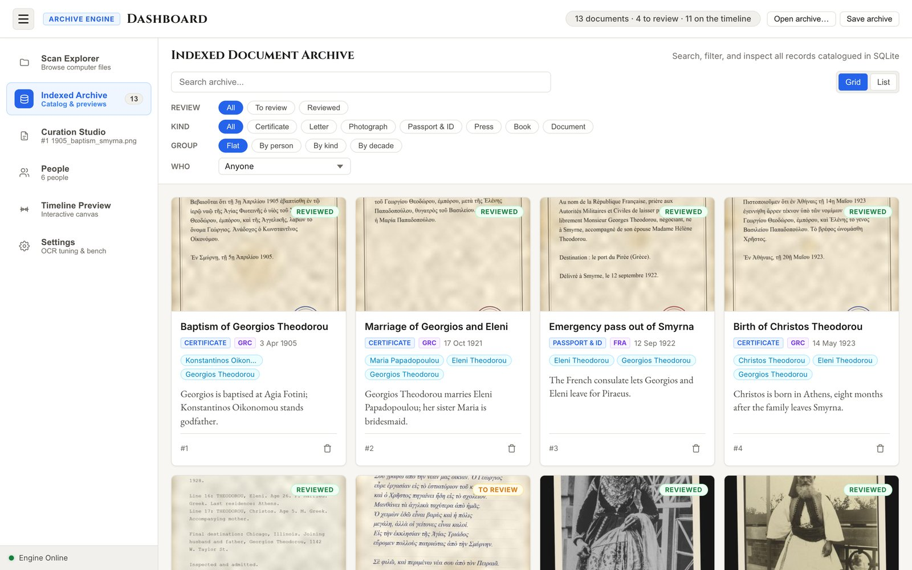
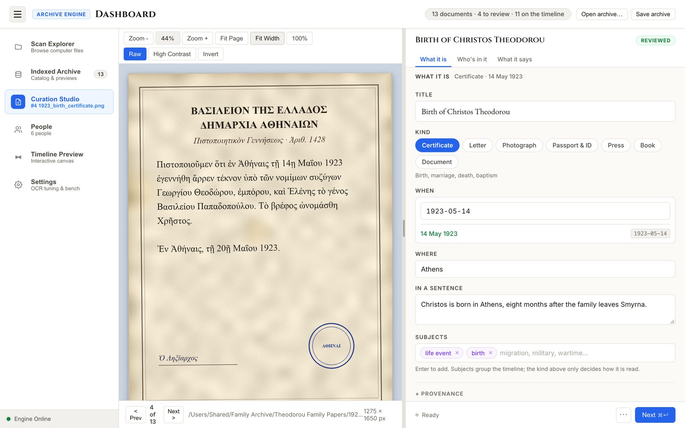
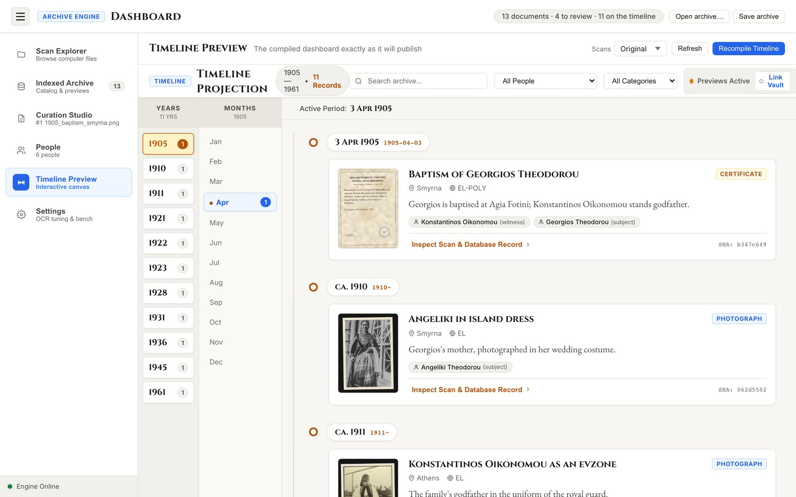

# ArchiveSys

**Turn a box of family papers and photographs into a searchable archive and an interactive timeline, entirely on your own computer.**




ArchiveSys is a local application for families, genealogists and small archives that hold historical scans. Point it at a folder of scans and it sorts them into documents and photographs, reads the text (polytonic Greek, modern Greek, French and English), and gives you one place to record what each item is, when it dates from, where it comes from and who is in it.

Nothing leaves your computer. Your scans are never modified.

## Features

- **Add a whole folder in one step.** A short wizard lists every file, flags copies of scans you already have (by content, not name), and adds the rest in the background.
- **Multi-page items stay together.** Scans named `12345`, `12345 1`, `12345 2` are treated as the pages of one item: described once, read page by page, shown once on the timeline.
- **Automatic sorting.** A text detector files each scan as a document or a photograph. Anything it cannot decide goes first in the review queue.
- **Local OCR.** Polytonic Greek (Katharevousa), modern Greek, French and English, with a character palette for correcting accents and breathings.
- **Dates the way historians write them.** Type `May 1923`, `c. 1912`, `1920s` or `1912–1915`; the date is stored in [EDTF](https://www.loc.gov/standards/datetime/) with its uncertainty intact.
- **People.** Link people to documents with a role (subject, author, recipient, witness, photographer…). Each person gets a page, and duplicates can be found and merged.
- **Search and filter.** Titles, transcriptions, places and people. Filter by review state, kind and person; group by person, kind or decade. Search ignores accents, breathings and case, so `θεοδωρου` finds `Θεοδώρου`.
- **A shareable timeline.** Export a folder anyone can open in a browser, with every scan at its original quality.
- **One portable file.** Save the whole archive (scans, records, and where you were working) as a `.archivesys` file, checked against fingerprints when opened.

## Installation

**Requirements:** Python 3.10 or later, and Tesseract 5 for reading text. The Greek, French and English language models ship with the project.

| Platform | Install Tesseract |
| --- | --- |
| macOS | `brew install tesseract` |
| Ubuntu / Debian | `sudo apt install tesseract-ocr` |
| Windows | `winget install UB-Mannheim.TesseractOCR` |

Sorting scans into documents and photographs does not need Tesseract.

```bash
git clone <repository-url> timeline_projection
cd timeline_projection
python3 -m pip install -e .

archivesys
```

`archivesys` creates the database if needed, starts the studio on the first free port from 8000, and opens it in your browser. Everything else happens there. To try it with sample records first, run `archivesys seed`; remove them with `archivesys clean --purge-samples`.

## Using the studio

Six views in the sidebar. Supported scan formats: PNG, JPEG, TIFF, WebP, BMP and PDF.

| View | What it's for |
| --- | --- |
| **Scan Explorer** | Browse folders on your computer, select scans or use **Add this folder…** to bring them in. |
| **Indexed Archive** | The catalogue: search, filter, group. Undecided scans are marked **Kind?** and come first in the review queue. |
| **Curation Studio** | The scan beside its record (title, kind, date, place, summary, people, transcription). Changes save as you type; **Done** (Cmd/Ctrl+Enter) marks the item reviewed and opens the next. |
| **People** | Everyone in the archive, with lifespan and document count. Edit, merge, choose a portrait. |
| **Timeline Preview** | The published timeline, built fresh from the archive. Jump by year, filter by person or category, and inspect any scan at full resolution. |
| **Settings** | OCR model choice, image preparation, and a tuning bench that scores configurations against a correct transcription. |



**Pages of one item.** Name the first page with a code or a name and the following pages with a space and a number, and the wizard groups them:

```text
14600.png   14600 1.png   14600 2.png        one item, 3 pages
photo1.png  photo1 1.png                     a print and its written back
```

Series numbered by the scanner itself (`Scan`, `Scan 1`, `Scan 2`) are usually unrelated, so they stay separate unless you choose **Combine as pages**.

**Saving and opening.** **Save archive** writes one `.archivesys` file; **Open archive…** (or dropping a file on the window) shows what it holds before anything changes. Every file is verified against its SHA-256 fingerprint first, the archive that was open is backed up to `data/backups/`, and nothing on disk is deleted or overwritten. The file is a ZIP laid out as a [BagIt](https://www.rfc-editor.org/rfc/rfc8493) bag around a SQLite database, so ordinary tools and any BagIt validator can read it.

## Publishing the timeline



**Recompile Timeline** in the studio, or:

```bash
archivesys export --output dist
```

produces `dist/index.html` and `dist/assets/scans/`. It needs no server: open `index.html` in any browser, and send the whole folder to share it. If only `index.html` arrives, the page still works with the 1000-pixel previews it carries.

Choose scan quality in **Settings → Sharing & Export**, with the **Scans** selector beside **Recompile Timeline**, or with `--quality`:

| Quality | Scans in `assets/scans/` | Typical size per scan |
| --- | --- | --- |
| **Original** (default) | Every scan byte for byte. TIFF and PDF scans also get a full-resolution JPEG, since browsers cannot display them. | As large as the scan (about 17 MB for a 600 dpi PNG) |
| **High** | Full resolution JPEG (quality 92, no chroma subsampling). Scans already in JPEG are copied as they are. | About 3 MB |
| **Compact** | 2400 px on the long side, JPEG quality 85. | Under 1 MB |

Each record carries the SHA-256 fingerprint of its original scan. A reader who has the originals can click **Link Vault** and choose their folder: the page matches files by fingerprint, even if renamed or moved.

`export` shares a read-only view. To move the archive itself for further work, use **Save archive**.

## Command line

| Command | What it does |
| --- | --- |
| `archivesys` / `archivesys open` | Start the studio (`--port`, `--no-browser`) |
| `archivesys open <file>.archivesys` | Open a saved archive, then start the studio where it was saved |
| `archivesys save [folder or file] [--name NAME]` | Save the whole archive to one `.archivesys` file |
| `archivesys verify <file>.archivesys` | Check a saved archive against its fingerprints |
| `archivesys index <path>` | Add a scan or folder without OCR (`--type` to set the kind) |
| `archivesys ingest <path> --ocr` | Add a scan or folder and read it (`--lang el-poly\|el\|fr\|en`) |
| `archivesys export [--output dist] [--quality original\|high\|compact]` | Export the timeline to a folder |
| `archivesys serve` | Serve the exported timeline locally |
| `archivesys status` | Show counts of documents, people and events |
| `archivesys seed` | Add sample multilingual records |
| `archivesys clean [--purge-samples]` | Remove records whose scans no longer exist, and optionally the samples |
| `archivesys help [command]` | Show help |

## Where your data lives

Everything is in the project's `data/` folder: `archive.db` (records, people, links), `thumbnails/`, `library/` (scans unpacked from an opened `.archivesys`), `backups/`, and `settings.json`. Your original scans stay where they are and are only ever read.

## How it works

```text
Scans → SHA-256 + thumbnail → Sort (PP-OCRv3 via OpenCV) → Prepare (CLAHE, binarise, deskew)
      → Read (Tesseract 5) → Normalise (NFC display, folded search keys)
      → Store (SQLite + FTS5) → Curate (FastAPI + browser studio)
      → Publish (Jinja2 timeline page; BagIt .archivesys)
```

- **Sorting** is a text-detection question, answered by PP-OCRv3 (2.4 MB) through OpenCV's DNN module rather than by OCR. It takes about 0.4 s a scan on any platform, and sorted all 76 labelled test scans correctly. Blank or near-empty pages are filed as documents and marked undecided.
- **Polytonic Greek** is stored exactly as written, in precomposed Unicode. Separate search keys strip combining marks and fold the final sigma; French accents are folded the same way. These feed an FTS5 index kept in step by database triggers.
- **Dates** are EDTF (`1923-05-14`, `1923~`, `192X`, `1912/1915`), each with a sortable decimal year for ordering on the timeline.

Source layout: `src/cli.py` (command line), `src/bundle.py` (`.archivesys` files), `src/curation/` (server, jobs, studio front end), `src/ingestion/` (sorting, OCR, normalisation), `src/database/` (schema, EDTF), `src/visualizer/` (timeline export), `tests/`.

## Development

```bash
python3 -m pip install -e ".[dev]"
python3 -m pytest tests/
```

Tests run in a temporary folder and never touch `data/`. When changing files in `src/curation/static/`, bump the `?v=` version on the asset links in `studio.html`; see [AGENTS.md](AGENTS.md).

## Credits and license

ArchiveSys is released under the [MIT License](LICENSE). The bundled text detection model is PP-OCRv3 from PaddleOCR, under the Apache License 2.0; see [NOTICE.md](src/ingestion/models/NOTICE.md).

The screenshots show a demonstration archive of a fictional family. The photographs are public-domain images from Wikimedia Commons: portraits by Augustus F. Sherman, Ellis Island, c. 1906–1914 ([New York Public Library](https://commons.wikimedia.org/wiki/File:%28Greek_soldier.%29_%283110163114%29.jpg), [via DPLA](https://commons.wikimedia.org/wiki/File:Greek_woman_-_DPLA_-_4a3cd3fade08c2e667ebcd59a9030ed2.jpg)), and a seaplane in Piraeus harbour, 1924–1925 ([ETH-Bibliothek Zürich](https://commons.wikimedia.org/wiki/File:ETH-BIB-Junkers_A_20_im_Hafen_von_Pyr%C3%A4us-Persienflug_1924-1925-LBS_MH02-02-0005-AL-FL.tif)).
